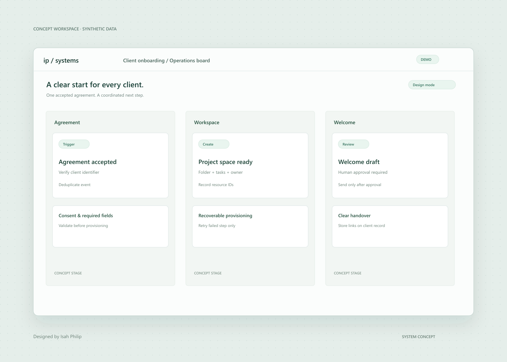

## The problem

The start of a client relationship often depends on several people remembering the same checklist. In this demo scenario, an accepted service agreement needs to become a project workspace, a document folder, and a clear next step for the client.

The aim is a coordinated onboarding process with an explicit human approval point before any client-facing welcome email. This is a proposed design, with synthetic data and no claimed client outcomes.

## Existing workflow

An operations owner sees an agreement notification, creates a Drive folder, copies a Notion project template, assigns tasks, and drafts a welcome email. Links are then pasted back into a client spreadsheet.

The process has no single completion state. If folder creation succeeds but the project setup fails, a manual restart can create duplicate resources. If the welcome is sent too early, the client can receive links to an incomplete workspace.

## System design

The accepted agreement is the source event. A stable client identifier connects all downstream resources, while an onboarding record tracks each provisioning step.



### A small state machine

The job moves through `validated`, `provisioning`, `awaiting-review`, and `complete`. Failures remain attached to the current step rather than resetting the whole process.

- **Validate the trigger.** Confirm the agreement status with its source API instead of trusting the notification alone.
- **Create resources once.** Record each folder and project identifier as soon as it is created.
- **Set permissions deliberately.** Use an approved access template; keep internal documents out of client-facing folders.
- **Prepare the welcome.** Build a draft from verified links, the named project owner, and an agreed kickoff checklist.
- **Require approval.** An operations owner reviews recipients, links, and wording before sending.

## Implementation

The illustrative stack uses Make for orchestration, the Notion API for the project record, Drive for documents, and the Gmail API for draft creation. The design can also be implemented in another workflow engine that supports persistent state and conditional retries.

```text
agreement accepted → confirm status → validate client record
  → create folder → save folder ID
  → create project → save project ID
  → create welcome draft → request human review
  → approved send → record completion
```

Resource creation uses a stored mapping between the agreement ID and each external resource. On a retry, the system verifies that saved resources still exist before attempting to create replacements. A human can pause or cancel an onboarding record without deleting already-created resources automatically.

Sensitive access links should never be logged as plain diagnostic text. Email recipients and external sharing settings must be visible in the review screen.

## Testing

These are acceptance criteria for a future sandbox implementation, not recorded results.

| Scenario | Expected behavior |
| --- | --- |
| Agreement accepted twice | Reuse the same onboarding record |
| Folder created, project API fails | Preserve the folder and retry only project setup |
| Client contact is missing | Stop before provisioning; request correction |
| Welcome is not approved | Keep a draft; send nothing to the client |
| Saved folder is unavailable | Pause and notify the operations owner |
| Internal template contains private content | Block external sharing pending review |

Before rollout, use sandbox recipients and a restricted test folder. Verify both the successful path and recovery after each external API call.

## Results

**This demo has no measured production outcomes.** It provides a workflow model, a permission-aware handoff, and a test plan for safely coordinating the start of a client engagement.

A pilot should compare checklist completion, incomplete onboarding records, duplicate resources, and time spent correcting setup errors. Client feedback should be collected with consent. Those observations would determine whether the design is useful in practice.

The next implementation step is to confirm the actual agreement platform, the workspace template, and who owns the final approval.
