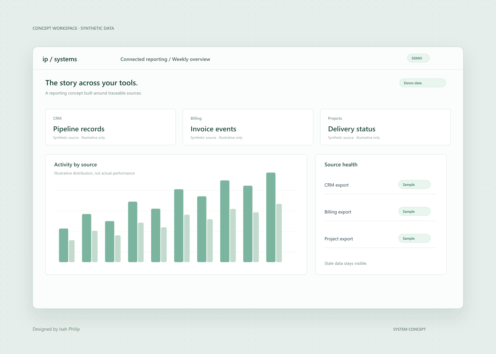

## The problem

A report can look precise while hiding inconsistent definitions. In this demonstration, an operations team assembles a weekly overview from its CRM, billing system, and project tracker. Each tool uses different identifiers and update schedules.

The goal is a report whose numbers can be traced to the source records and whose missing or stale data is visible. The cover uses illustrative data only. It does not represent business performance.

## Existing workflow

An analyst exports three CSV files, reconciles company names in a spreadsheet, removes duplicates, and writes a short narrative. A late invoice correction or renamed customer can change the totals after the report has been shared.

The recurring work includes more than data movement: it also includes decisions about cutoff times, currencies, project status, and which records should be counted. Those definitions need to be agreed before any automation is built.

## System design

The proposed pipeline separates ingestion, normalization, calculation, and narrative generation. Source records retain their original identifiers and extraction timestamp.



- **Ingest incrementally.** Use supported updated-since cursors, with a controlled overlap window for late changes.
- **Preserve lineage.** Store source IDs and fetch timestamps alongside each normalized record.
- **Define the joins.** Match customers through verified identifiers; send ambiguous matches for review.
- **Calculate in SQL.** Version the metric definitions and set a clear reporting cutoff.
- **Expose freshness.** Mark a source as stale when it misses the agreed window. Do not silently present the previous period as current.

### Where AI belongs

An optional AI step can draft a narrative from approved aggregate fields. It should not calculate totals, resolve customer identities, or invent explanations for a change. The prompt treats source text as untrusted data, limits the output structure, and requires a human to approve the narrative before distribution.

## Implementation

This implementation plan uses scheduled Python jobs for API ingestion, PostgreSQL for normalized records and metric queries, and a static report export. No business accounts are connected in this demo.

```text
fetch sources → store raw references → validate schema
  → normalize identifiers → reconcile exceptions
  → calculate approved metrics → check freshness
  → draft optional narrative → human review → publish
```

Each run receives an immutable run identifier. Idempotent upserts use the source system and record ID as the unique key. A report references the completed run and metric-definition version so it can be reproduced later.

Credentials use the host’s secret store. Read-only source access is preferred. Reports contain only approved aggregates, and raw customer records stay out of the AI prompt.

## Testing

These proposed checks describe how a future implementation would be evaluated.

| Scenario | Expected behavior |
| --- | --- |
| API pagination spans several pages | Every expected source record is ingested once |
| One source misses its refresh window | Report identifies stale data and holds publication if required |
| Customer match is ambiguous | Review queue, with no silent join |
| Same run is replayed | Stable totals and no duplicate records |
| Invoice is corrected after cutoff | Revision appears in the next controlled reporting run |
| AI narrative contains unsupported claims | Schema or reviewer rejects the draft |

Reconciliation should compare source counts and totals against a hand-checked fixture. Tests should cover time zones, currency treatment, deleted records, schema drift, and recoverable API errors.

## Results

**There are no production metrics or client results for this demo.** The deliverable is a traceable reporting architecture and an acceptance-test plan, illustrated with synthetic data.

In a real pilot, assess preparation time, reconciliation exceptions, source freshness, and the number of corrections after distribution. A useful report should make uncertainty easier to see, as well as reducing repetitive exports.

The next step would be a metric-definition workshop and a narrow pilot using one source pair before adding AI-assisted summaries.
