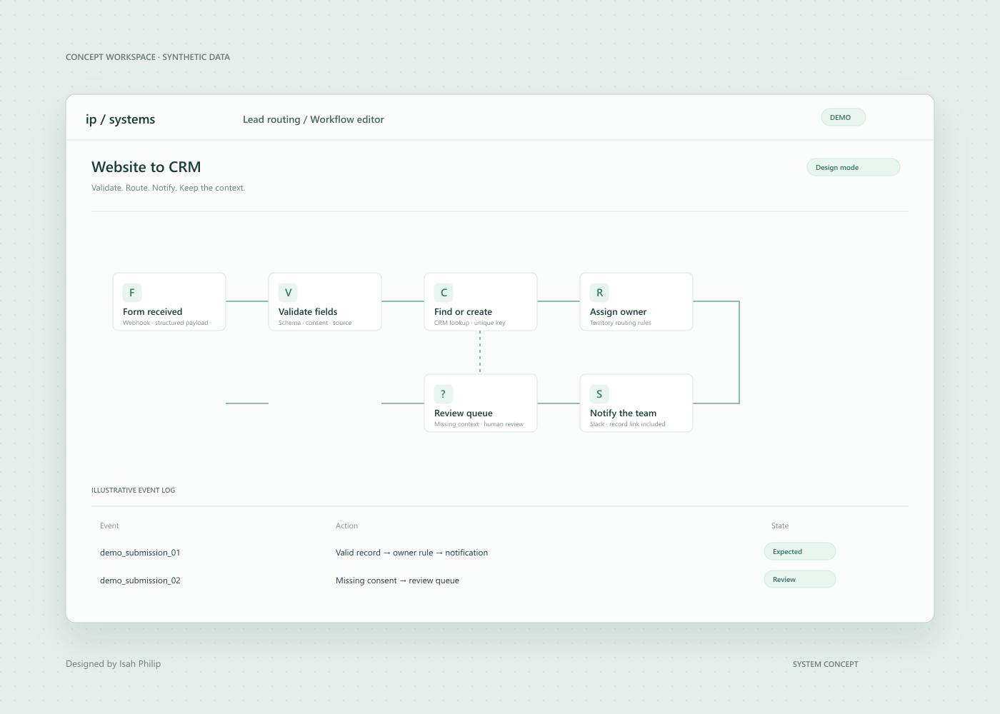

## The problem

An enquiry is useful only when the right person can act on it. In this demonstration, a growing services business receives enquiries through a website form. A shared inbox becomes the handoff point, but it does not make ownership or progress visible.

The design goal is a traceable path from form submission to an assigned CRM record. This is an illustrative scenario; no real customer data or client performance figures are used.

## Existing workflow

1. A visitor submits a name, work email, service interest, and message.
2. An administrator reads the notification and copies the details into HubSpot.
3. The administrator checks for an existing contact, chooses an owner, and posts a message to the team.
4. If context is missing, the enquiry stays in the inbox until someone notices.

The weak points are duplicate records, inconsistent field names, and a handoff with no explicit failure state. Automating only the record creation would leave those problems unresolved.

## System design

The proposed system uses a webhook entry point and a deterministic routing layer. AI is intentionally unnecessary here: explicit rules are easier to explain and audit for a small set of service categories.



- **Validate first.** Accept only the expected fields, limit message length, and check that the form captures the required permission to contact the sender.
- **Keep an event key.** Persist the form submission identifier before processing. Repeated deliveries should refer to the same job.
- **Find before creating.** Normalize the email address, search the CRM, and update only the agreed fields on an existing record.
- **Assign visibly.** Resolve an owner from a versioned service-to-team mapping. Unknown categories go to a review queue.
- **Notify with context.** Post a CRM link and a short summary, while avoiding unnecessary personal data in Slack.

### The recovery path

CRM writes and notifications have separate states. A Slack outage must not cause another contact to be created. A failed step stores the error category and retry count; an operator can retry that step using the original event key.

## Implementation

This is an implementation plan, rather than a deployed integration. The example can be built with an n8n webhook, a schema-validation step, a durable job store, HubSpot API calls, and a Slack notification step.

```text
receive → validate → persist event key
  → search CRM → create or update → assign owner
  → record CRM ID → notify → mark complete
invalid input or unknown routing rule → review queue
```

Credentials belong in the workflow platform’s secret store. The CRM token should have only the scopes required for the selected objects. The webhook should verify a sender signature when available, apply rate limits, and avoid storing raw request bodies in routine logs.

## Testing

The following are proposed acceptance tests. They have not been run against a live CRM in this demonstration.

| Scenario | Expected behavior |
| --- | --- |
| New, valid enquiry | One CRM contact, an assigned owner, and a notification |
| Same event delivered twice | One job and no duplicate contact or notification |
| Existing contact | Agreed fields updated without overwriting unrelated CRM data |
| CRM rate limit | Respect retry guidance, then resume from the failed step |
| Missing required field | No CRM write; a review item records the reason |
| Notification outage | Keep the CRM write and retry only the notification |

A sandbox run should also verify credential failures, malformed payloads, retention rules, and a manual replay from the review queue.

## Results

**No production results are claimed.** The output of this demo is an architecture, a recovery strategy, an illustrative interface, and an acceptance-test plan.

The expected benefit is a visible owner and a recoverable handoff for every valid enquiry. To evaluate that in a real rollout, record the baseline time to assignment, duplicate rate, unresolved failures, and the proportion of records needing manual correction. Compare the same measures after a controlled pilot before claiming an improvement.

The next step would be to agree the field mapping and ownership rules with the sales team, then validate the workflow against a sandbox CRM.
